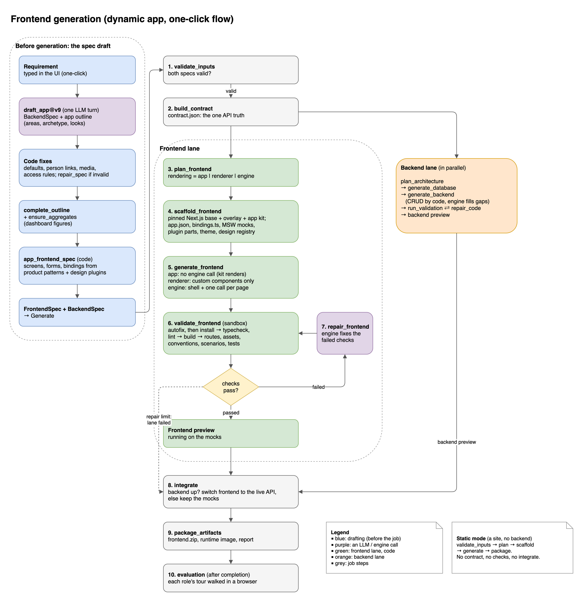
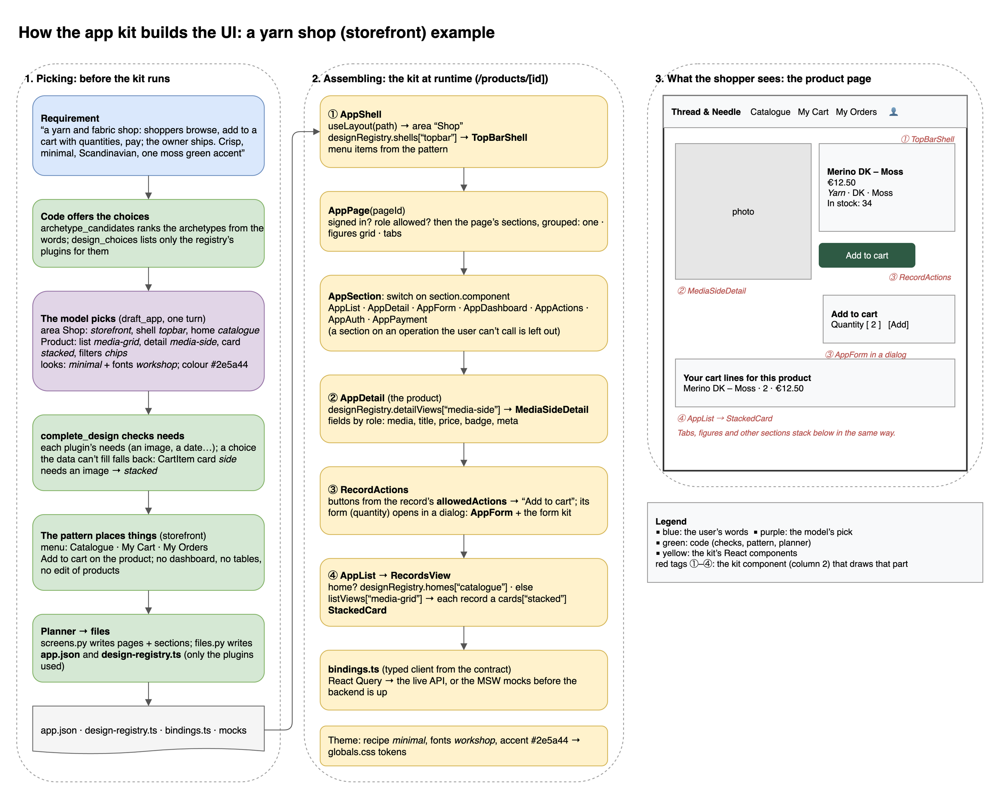
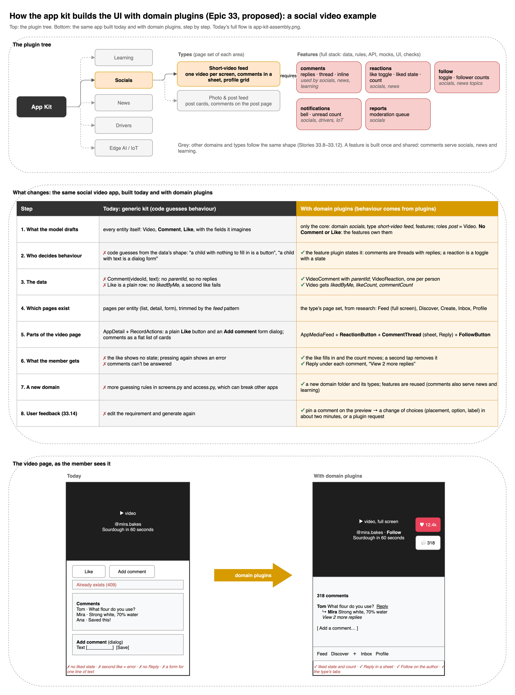

# How the frontend is generated

This page follows a **dynamic app** (frontend + backend from one requirement) from the requirement typed in the UI to
a running, checked frontend. Static sites take a shorter path, described at the end.



The diagram's source is [docs/diagrams/frontend-generation.drawio](docs/diagrams/frontend-generation.drawio). Open it
in draw.io Desktop, and re-export the PNG after a change:

```bash
/Applications/draw.io.app/Contents/MacOS/draw.io -x -f png -s 2 -b 20 \
  -o docs/diagrams/frontend-generation.png docs/diagrams/frontend-generation.drawio
```

**The main idea:** the model decides *what* the app is (its data, roles, areas and look). Code decides *how* the
screens are built. One LLM turn writes the specs, and every screen is planned and rendered by code. An engine only
touches the frontend to repair a failed check.

## Before generation: the spec draft

The one-click flow first drafts the specs (`POST /api/v1/spec-drafts`). The worker runs
`agent-api/src/orchestrator/drafting/app.py` → `draft_app`.

| Step | What happens | Where |
|---|---|---|
| a. Requirement | The user types the requirement in the UI. | `agent-ui` |
| b. One LLM turn | `draft_app@v9` writes the **BackendSpec** (entities, operations, roles, rules) and the **app outline** (areas, archetype per area, menu, home, look, where records are created). It runs on the draft engine picked by `DEFAULT_ENGINE` (`antigravity_json` or `claude_code_json`), using structured output. | `prompts/draft_app/v9.md` |
| c. Code fixes | Mechanical mistakes are fixed without a model: defaults, person relationships, media fields. The **access rules** (who may see and do what) are applied. `repair_spec` (another LLM turn) runs only if the BackendSpec is still invalid. | `drafting/app.py`, `drafting/access.py` |
| d. Outline completed | `complete_outline` fills what the outline left out from the BackendSpec. `ensure_aggregates` adds the dashboard's figures as aggregate operations. | `frontend/app/outline.py`, `frontend/app/screens.py` |
| e. Screens planned | `app_frontend_spec` turns outline + contract into the **FrontendSpec**: pages, sections, forms and one binding per operation. It follows each area's **product pattern** (`back-office`, `feed`, `catalogue`, `storefront`) and the **design plugins** (shell, list view, detail view, home, card, recipe, fonts). | `frontend/app/screens.py`, `frontend/app/patterns.py`, `templates/design/` |
| f. Generate | The FrontendSpec + BackendSpec start a generation (`mode: dynamic`). | `POST /api/v1/generations` |

## The generation

The generation is a LangGraph workflow (`agent-api/src/orchestrator/graph.py`). After two shared steps, the frontend
and backend lanes run **in parallel**. Neither lane's failure stops the other.

### 1. `validate_inputs`

Checks both specs, including the pair check: every operation is covered by a screen and every binding points at a
real operation. An invalid spec ends the job here.

### 2. `build_contract`

Builds `contract.json`, the OpenAPI contract with `x-bga` extensions: sources, references, errors, scenarios,
`allowedActions`, entities. **The backend decides and the frontend only reads.** Both lanes are generated against
this one file, and the frontend's mocks emulate it. Code: `orchestrator/integration/contract.py`.

### 3. `plan_frontend`

`plan_frontend` (`orchestrator/frontend/planner.py`) picks how the site is rendered:

| `rendering` | When | Who writes the pages |
|---|---|---|
| `app` | every dynamic app (`project.flow: "app"`) | the **app kit** renders every screen from `app.json`; no engine call |
| `renderer` | a static site the section library can draw | the library, plus any custom components |
| `engine` | a static site with gaps the library can't cover | an engine call for the shell and one per page |

For apps, `frontend/app/plan.py` writes the plan: routes, sections, forms, bindings, the plugins and design plugins
used, and the patterns.

### 4. `scaffold_frontend`

`orchestrator/frontend/scaffold.py` writes the project. The engine may not edit these generated files.

- The pinned Next.js base (`templates/nextjs_base`, never edited by hand) and the overlay (`templates/nextjs_overlay`).
- For apps, the **app kit** (`files/dynamic/app/`: `AppShell`, `AppPage`, `AppList`, `AppDetail`, `AppForm`,
  `AppDashboard`, `RecordActions`, the form kit, the tour).
- `src/content/app.json`: pages, routes, forms, field types, references and access per operation.
- `bindings.ts`, the typed API client generated from the contract.
- MSW mocks and `scenarios.json`, so the app runs and is tested **without** the backend.
- The plugin frontends the contract needs (auth, storage, payments, relations), the theme, fonts and
  `design-registry.ts`.
- Uploaded assets, copied to `public/assets/`.
- The shared `node_modules` volume, warmed up in the background.

### 5. `generate_frontend`

- **App:** nothing to generate. The kit renders every screen, so there are 0 engine calls. The opt-in view slots
  (`APP_VIEW_SLOTS=engine`) are the exception.
- **Renderer:** only the custom components, each in parallel or taken from the component cache.
- **Engine:** the shell first, then one engine call per page.

### 6. `validate_frontend`

`autofix` runs first: generated files are restored and `eslint --fix` runs. Then the checks run in a Node sandbox
(`bga-runner-node`), each stored as `frontend:<check>`:

`install` → `typecheck` · `lint` → `build` → `routes` · `assets` · `conventions` · `scenarios` · `tests`

The `scenarios` check runs only for apps. It plays every contract scenario against the MSW mocks, so a mock that
breaks the contract fails here.

### 7. `repair_frontend` (when a check fails)

An engine gets the failed checks' digest and the files they point at, fixes them, and the checks run again. The
default limit is 3 attempts (`maxRepairAttempts`). If a check fails only in generator-owned files, no repair is tried:
it's a generator bug. At the limit, the frontend lane fails, and the backend lane carries on.

When every check passes, the lane packages the frontend and starts its **preview on the mocks**, so it can be used
before the backend is ready.

### 8. `integrate`

`integrate` waits for both lanes (`orchestrator/integration/integrate.py`):

- If the backend preview is up, the frontend preview is switched to the **live API**.
- If the backend failed or isn't ready, the frontend keeps the mocks, and the job ends with warnings.
- If both lanes failed, the job fails.

### 9. `package_artifacts`

Writes `frontend.zip` and `frontend-runtime.tar.gz`, from which the preview image is built without a second
`next build`. Also writes `contract.json` and the report (`report.json`, `report.md`) under
`.data/artifacts/<generation>/`.

### 10. Evaluation (after a completed generation)

`orchestrator/evaluation/` walks each role's **tour** in a browser: it signs in as the role's demo user, follows the
business workflows and screenshots each step. The result is shown in the Business tab. The evaluation never changes
the generation.

## How the app kit builds the UI

An app's UI is never written per app. Every app runs the same **app kit**, a set of React components in
`agent-api/templates/nextjs_overlay/files/dynamic/app/`. What changes from app to app is **data**:

- `src/content/app.json` says which pages exist and which sections each page has.
- `src/components/app/design-registry.ts` says which design plugin draws each part.
- `bindings.ts` is the typed API client.

The kit reads these files and assembles each screen at runtime. This section follows a real e-commerce draft (the
Thread & Needle yarn shop, a recorded draft in `agent-api/tests/fixtures/drafts/thread-and-needle/`) through the
planner.



Source: [docs/diagrams/app-kit-assembly.drawio](docs/diagrams/app-kit-assembly.drawio).

### 1. Picking: who decides which component

Each choice is made by one party. The model only picks from lists that code gives it, and code checks every pick.

| Decision | Who decides | How | Yarn shop |
|---|---|---|---|
| What kind of product each area is (archetype) | code ranks, the model picks | `archetype_candidates` ranks archetypes from the requirement's words. The model names one per area. | Shop: `storefront`; Store Management: `back-office` |
| Which components are on offer | code | `design_choices` lists only the registry's plugins for those archetypes (`templates/design/<kind>/<name>/`). | shells, list views, detail views, homes, cards, filters, recipes, font pairings |
| Shell, home, list view, detail view, card, filters | the model | written in the outline's `design` | shell `topbar`, home `catalogue`, Product list `media-grid`, detail `media-side`, card `stacked`, filters `chips` |
| The look | the model, then the requirement | three looks (recipe + font pairing); `follow_requested` applies the colours the requirement asks for | `minimal` + `workshop` fonts, moss green `#2e5a44` |
| Whether a pick fits the data | code | `complete_design` checks each plugin's `needs` and falls back along its `fallback` chain when the data can't fill it. | CartItem card `side` needs an image, so it becomes `stacked` |
| The menu, where actions go, what people never see | code: the area's **product pattern** | `frontend/app/patterns.py` and `templates/design/pattern/<archetype>/plugin.json` | menu Catalogue · My Cart · My Orders; Add to cart on the product; no dashboard, no tables, no product editing for shoppers |
| Who may do what | code: access rules + the contract | `drafting/access.py`; each record's `allowedActions` | a shopper sees only their own cart and orders |

### 2. Planning: which pages and sections

`screens.py` turns the outline + contract into pages, and each page is a list of **sections** (one kit component
each, bound to one operation). `files.py` writes them into `app.json`, and writes `design-registry.ts` importing only
the plugins the app uses. These are the shopper's pages from the real planner output:

| Route | Sections | What the shopper sees |
|---|---|---|
| `/` (home) | `AppList(Product)` | the `catalogue` home: product rows by category |
| `/products` | `AppList(Product)` | a `media-grid` of product cards (photo, name, price, category) |
| `/products/[id]` | `AppDetail(Product)` + `AppList(CartItem)` | the product, photo beside its fields (`media-side`), an **Add to cart** button whose quantity form opens in a dialog, then the shopper's cart lines for it |
| `/cart-items` (My Cart) | `AppList(CartItem)` | cart lines as `stacked` cards, with Edit and Delete |
| `/cart-items/[id]/edit` | `AppForm(CartItem)` | change the quantity |
| `/orders` (My Orders) | `AppActions(Order)` + `AppList(Order)` | **Check out and pay**, then the shopper's orders, with Pay on unpaid ones |
| `/orders/[id]` | `AppDetail(Order)` | one order, with Pay |
| `/payments/success`, `/payments/cancel` | `AppPayment(Order)` | the payment result (payments plugin) |
| `/login`, `/register` | `AppAuth` | sign-in and sign-up (auth plugin) |

The owner's area (`/owner-area`) uses the `back-office` pattern on a `sidebar` shell. It gets dashboard figures
(`AppDashboard`), tables, new and edit forms for products, and the order actions (Mark as shipped, Mark as
delivered). It's the same kit with different data.

The design registry generated for this app:

```ts
export const designRegistry = {
  shells:      { sidebar: SidebarShell, topbar: TopBarShell },
  listViews:   { table: TableRows, cards: RoleCards, "media-grid": MediaGrid },
  detailViews: { "media-side": MediaSideDetail, "split-panel": SplitPanelDetail },
  homes:       { catalogue: CatalogueRows },
  cards:       { stacked: StackedCard, "text-first": TextFirstCard },
  // ...
};
```

### 3. Assembling: the kit at runtime

Take the product page `/products/[id]`. The kit builds it in this order:

1. **`AppShell`**: `useLayout(path)` finds the area whose `prefix` starts the path ("Shop", prefix `/`), takes its
   design and renders `designRegistry.shells["topbar"]`, the `TopBarShell`. The menu comes from the pattern, and items
   a role can't use are hidden.
2. **`AppPage`**: looks up the page in `app.json`. It sends a signed-out user to sign in and shows "not for your role"
   when the page's operation isn't allowed. It then groups the sections: a single section, dashboard figures in a
   grid, or a parent's children in tabs.
3. **`AppSection`**: switches on `section.component`: `AppList`, `AppDetail`, `AppForm`, `AppDashboard`,
   `AppActions`, or a plugin part (`AppAuth`, `AppPayment`, `AppLinks`). A section on an operation the user can't call
   is left out.
4. **`AppDetail`**: renders `designRegistry.detailViews["media-side"]`. The fields are placed by their **roles** from
   the design (media, title, price, badge, meta, stat), not by name. With the `feed` pattern, the record's view is
   counted when it opens (`onOpen`).
5. **`RecordActions`**: one button per action in the record's `allowedActions` (from the API), so a shopper never
   sees Edit or Delete on a product. "Add to cart" has fields to fill, so its form (`AppForm` + the form kit:
   pickers, calendars, money and unit inputs) opens in a dialog. An action with nothing to fill in (a like, a save)
   is one click.
6. **`AppList` → `RecordsView`**: a home list renders `designRegistry.homes[...]`, other lists render
   `designRegistry.listViews[design.view]`, and each record in a grid is drawn by
   `designRegistry.cards[design.card]`. A name missing from the registry falls back to the kind's first builtin.
7. **Data**: every section calls the API through `bindings.ts` with React Query: the live API, or the MSW mocks
   before the backend is up. Errors from the API are mapped onto the form's fields (422, 409).
8. **Theme**: the recipe, font pairing and colours become CSS tokens in `globals.css`. Components use tokens only,
   so the same `StackedCard` looks Scandinavian here and neon in another app.

### Adding a component

A new look or layout is a **design plugin**, not a change to the kit. You add a folder
`templates/design/<kind>/<name>/` with a `plugin.json` (kind, the archetypes it suits, what it `needs`, its
fallback) and its React files.

- `make design-plugin-new` creates the folder.
- `make design-plugin-check` runs its gates: recipes, states, keyboard, contrast.
- Once it's `ready`, the registry offers it to the model for its archetypes, and the kit dispatches to it.

A new product behaviour, such as how a booking app should work, is a new `pattern` plugin. See
`docs/development/design-plugins.md`.

### Planned: domain plugins (Epic 33)

Today the kit builds every product from generic parts, so behaviour like replies or a like's state has to be guessed
from the data. Epic 33 proposes a domain level above the patterns. The model picks a domain (learning, socials, news,
drivers, edge AI / IoT), a type per area (its page set) and features. Features are full-stack plugins (comments with
replies, reactions with state, follow, dispatch, telemetry…) that bring their own data, rules, API and screen parts.



Source: [docs/diagrams/app-kit-assembly-domains.drawio](docs/diagrams/app-kit-assembly-domains.drawio). The plan is
in [pdm/epic33_domain_plugins/](pdm/epic33_domain_plugins/epic33_domain_plugins.md).

## Static sites

A static site (`mode: static`, content baked in, no backend) is drafted by `draft_frontend_spec`, with direction
cards and optional designed page trees. Its job is shorter:

`validate_inputs` → `plan_frontend` → `scaffold_frontend` → `generate_frontend` → `package_artifacts`

There's no contract, no frontend check or repair step, and no integrate. Most static sites render with the section
library (`rendering: "renderer"`).

## Where to look

| Question | File |
|---|---|
| The workflow and its routes | `agent-api/src/orchestrator/graph.py`, `state.py` |
| The frontend lane's nodes | `agent-api/src/orchestrator/frontend/nodes.py` |
| App screens (patterns, placements, menus) | `agent-api/src/orchestrator/frontend/app/screens.py`, `patterns.py` |
| The kit's React components | `agent-api/templates/nextjs_overlay/files/dynamic/app/src/components/app/` (`AppShell`, `AppPage`, `AppSection`, `AppList`, `AppDetail`, `RecordActions`, `views.tsx`, `details.tsx`, `shells.tsx`) |
| What goes into `app.json` and `design-registry.ts` | `agent-api/src/orchestrator/frontend/app/files.py` |
| The design choices and their checks | `agent-api/src/orchestrator/frontend/app/design.py` (`complete_design`), `modules/shared/domain/frontend_spec/design_registry.py` |
| Design and pattern plugins | `agent-api/templates/design/<kind>/<name>/plugin.json` |
| Frontend checks | `agent-api/src/orchestrator/frontend/validation.py` |
| Engine settings (which model does what) | `.env` → `DEFAULT_ENGINE`, `ANTIGRAVITY_MODEL`, `CLAUDE_CODE_MODEL`, `DRAFT_SPEED` |
