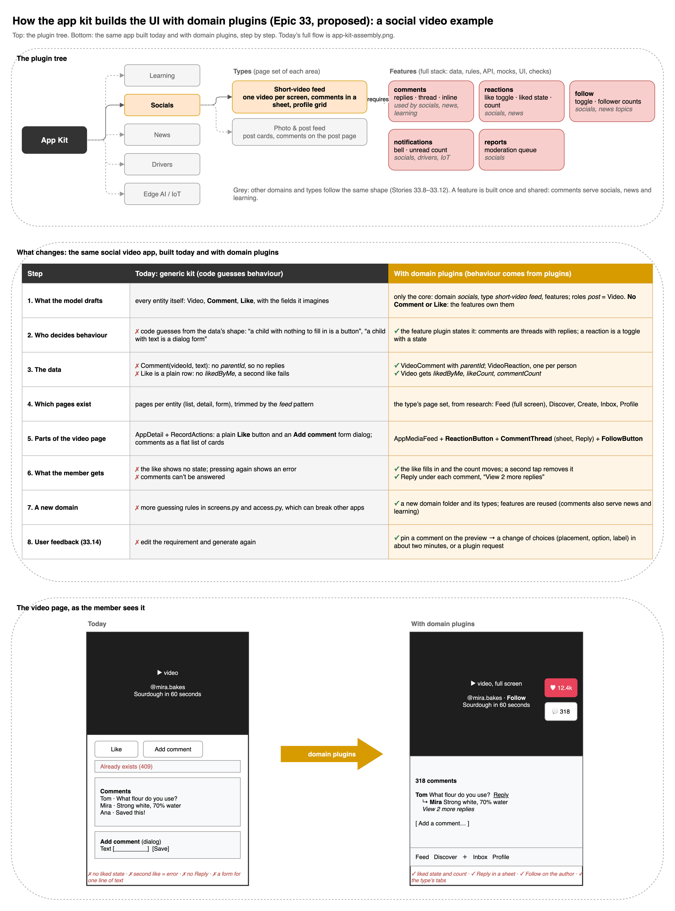

# Epic 33 — Domain plugins: apps built from what each kind of product really is

## Overview

Proposed 2026-11-10 for the user's review. Epic 32 gave each area a **pattern** (how a feed, a storefront or a
back-office behaves), and Epic 30 gave it a **look** (design plugins). Both still build every app out of the same
generic parts: the model drafts plain entities (Video, Comment, Like) and code guesses each one's behaviour from the
shape of its data. That guessing has a ceiling, and the real runs keep hitting it:

| Seen in real runs (2026-11-09) | Why a general rule can't fix it |
|---|---|
| Comments with no replies | Nothing in "a Comment belongs to a Video" says comments are threads |
| A like on its own tab, with no "liked" state on the button | The kit can't know a row is a toggle of the person's own reaction |
| The shopper types a cart line's price | The model drafted the price as a field to fill in; no rule knows it should be copied from the product |
| The shop owner's menu says "My Cart", "My Orders" | Storefront wording leaks into a back-office area |
| Each fix is one more rule in `screens.py` and `access.py` | Every new domain multiplies the rules |

This epic adds three levels of plugins:

```
Domain   learning · socials · news · drivers · IoT     what the product must have: core entities by role,
  │                                                     areas and their people, required and optional features,
  │                                                     its UX tasks
  ├─ Type   course catalogue · short-video feed …       the page set of each area and what each page holds
  │                                                     (slots bound by role), researched from real products
  └─ Feature  comments · reactions · follow ·           full-stack: entities, operations, rules, contract
              enrollment · dispatch …                   scenarios, mocks, kit components, UX checks
```

A **feature** is built once and shared across domains: comments serve socials, news and learning. It works like the
payments and storage plugins already do: it brings its own entities and API, so the model never drafts a Comment
entity. It only says "this app has comments on posts". Replies, the liked state and the inline placement are then
correct by construction.

The first five domains, as the user asked: **learning platform**, **socials**, **news**, **drivers** (a delivery
courier app: a driver receives an order, picks it up and hands it to the customer), and **edge AI / IoT** (sensors
and cameras send readings and detections; people watch them on a dashboard and manage the devices).

**Requirements:** FR-47 (new, proposed: domain plugins), extends FR-46 (patterns), FR-44 (design plugins) and
FR-34 (backend feature plugins).

## Decisions (proposed 2026-11-10)

| # | Decision | Instead of |
|---|---|---|
| D1 | **Three plugin kinds**: `domain`, `type` (belongs to one domain) and `feature` (shared). Folders under `templates/domains/<domain>/` (its types in `types/<type>/`) and `templates/features/<feature>/`, read by one registry like Epic 30's | Behaviour spread through `screens.py` as rules |
| D2 | **Features are full-stack and own their data.** A feature declares its entities, operations, rules, scenarios, mock behaviour, kit components and UX checks, and attaches to the draft's core entities **by role** (`comments` on the domain's `content`). Code merges them into the BackendSpec; the model never drafts them | The model drafting Comment, Like, Enrollment and code guessing their behaviour |
| D3 | **A domain is a contract.** It names its core entities by role (learning: `course`, `lesson`; drivers: `delivery`), its areas and roles, its required and optional features, and the checks a draft must pass. A draft that fails the contract is repaired once, then falls back to today's generic path | A domain that only changes the look |
| D4 | **A type is a page inventory.** Each area's pages, each page's slots (gallery, price, curriculum, comment thread…) bound to fields by role, the main tasks and their click budgets. It's written from a research checklist of 5–8 leading products' structure (D7) | Layouts invented per generation |
| D5 | **The model picks, code checks** (Epic 23's D1): code ranks domain candidates from the requirement; `draft_app@v10` picks the domain, the type per area and the optional features; code validates each pick and falls back where it can't be filled | The model laying out screens or writing UI code |
| D6 | **Patterns and design plugins stay.** A type's areas use a pattern for the menu and placement rules and design plugins for the look. An app outside every domain is generated exactly as today | Replacing Epic 30 and 32 |
| D7 | **Study structure, never copy a product.** Research records pages, sections, flows and click counts; the look comes from our recipes. No product's name, branding, copy or assets, whatever the requirement names (Epic 30's D8) | Cloning a known app |
| D8 | **The requirement wins**: what it says about placement, audience or privacy overrides the type, with a note (Epic 32's D8) | A type that ignores the user |
| D9 | **Measure first**: one reference requirement per domain is generated with today's kit before any change, and its UX tasks are recorded as the baseline (32.1's method) | Judging by screenshots |
| D10 | **Out of scope for the first five domains:** real-time push (offers, feeds and dashboards refresh by polling), maps and GPS (addresses are text, the route is a link out), native gestures (a swipe is a scroll), payments to drivers (earnings are a ledger, not a payout), device protocols other than HTTPS (no MQTT broker, no firmware) and live video streams (cameras send snapshots and detections) | A first version that waits on infrastructure |
| D11 | **IoT apps are never empty.** Devices are simulated: the seed and the preview run a simulator that posts readings and detections through the same ingestion API a real device uses, so the dashboard has data from the first minute | Charts with nothing to draw until hardware is connected |

```
 requirement ──▶ code ranks domains ──▶ draft_app@v10: domain · type per area · optional features
                                          │  + core entities by role (Course, Lesson / Post / Article / Delivery)
                                          ▼
                        domain contract check ──(fails twice)──▶ today's generic path (patterns, Epic 32)
                                          │ passes
                                          ▼
   features merge their entities, operations, rules ──▶ BackendSpec ──▶ backend plugins, contract, mocks
                                          │
                                          ▼
   type pages + slots (bound by role) + pattern rules ──▶ screens ──▶ kit: domain components + design plugins
```

How the kit assembles an app with domain plugins (a social video example):



## The first five domains

| Domain | Core entities (by role) | Areas and people | Features | Types |
|---|---|---|---|---|
| **Learning platform** | `course`, `lesson` (in a course), `instructor` | Learners · Instructors · Admin (back-office) | enrollment + progress, quiz, discussion (comments), reviews, certificates (optional) | course catalogue (self-paced), classroom (cohorts with due dates) |
| **Socials** | `post` (text, photo or video), `member` | Members (create and consume) · Moderators | comments with replies, reactions with state, follow, notifications, reports (moderation) | short-video feed, photo and post feed |
| **News** | `article`, `section` (topic), `author` | Readers · Newsroom (writers and editors) | editorial workflow (draft → review → published), bookmarks (reactions), follow topics, comments | magazine (front page by section), link aggregator (upvotes, ranked) |
| **Drivers** | `delivery` (an order to move), `stop` (pickup and drop-off) | Drivers (mobile-first) · Customers (track) · Dispatch (merchant or operator) | dispatch (offer → accept → picked up → delivered), availability (online / offline), proof of delivery (photo, code), earnings ledger, tracking timeline | courier |
| **Edge AI / IoT** | `device` (sensor or camera), `site` (a place with zones), `metric` (what a sensor measures, with its unit) | Operators (watch, acknowledge) · Admins (devices, rules) · Devices (an API key each) | telemetry (ingest, time series, aggregates, charts), device registry (status, last seen, battery, firmware), detections (camera events: label, confidence, snapshot), alert rules (threshold or detection → alert → acknowledge → resolve), commands (reboot, set interval), simulator (D11) | sensor monitoring (fleet dashboard), vision ops (camera detections and review) |

## Stories

| Story | What |
|---|---|
| [33.1](story33.1_baseline_and_tasks.md) | One reference requirement per domain, generated with today's kit; the UX tasks per domain and the baseline |
| [33.2](story33.2_research_page_inventories.md) | Research: a page inventory per type from 5–8 real products' structure, as reviewed documents |
| [33.3](story33.3_plugin_kinds.md) | The `domain`, `type` and `feature` kinds: descriptors, registry, validation, the generic fallback |
| [33.4](story33.4_feature_engine.md) | The feature engine: attach by role, merge entities and operations, backend code, scenarios, mocks, kit parts |
| [33.5](story33.5_comments_and_reactions.md) | The first two features: comments with replies, reactions with state |
| [33.6](story33.6_drafting_picks_the_domain.md) | `draft_app@v10`: the domain, the type per area, optional features; the domain contract check and fallback |
| [33.7](story33.7_planner_builds_type_pages.md) | The planner builds a type's pages and slots; patterns keep the menu and placement rules |
| [33.8](story33.8_socials_domain.md) | Socials: follow, notifications, reports; short-video and post feed types |
| [33.9](story33.9_news_domain.md) | News: editorial workflow, follow topics; magazine and link aggregator types |
| [33.10](story33.10_learning_domain.md) | Learning: enrollment and progress, quiz, certificates; course catalogue and classroom types |
| [33.11](story33.11_drivers_domain.md) | Drivers: dispatch, availability, proof of delivery, earnings, tracking; the courier type |
| [33.12](story33.12_iot_domain.md) | Edge AI / IoT: telemetry, device registry, detections, alert rules, commands, the simulator; sensor monitoring and vision ops types |
| [33.13](story33.13_final_check.md) | Final check: the five reference requirements and five fresh ones in the UI, against the baseline |
| [33.14](story33.14_feedback_on_screens.md) | Feedback on screens: the user pins a comment on the preview; it becomes a change of choices, a data change, or a plugin request |

Order: 33.1 → 33.2 → 33.3 → 33.4 → 33.5 → 33.6 → 33.7, then one domain at a time: 33.8 (socials, the first proof:
it uses the two features of 33.5) → 33.9 → 33.10 → 33.11 → 33.12 → 33.13 → 33.14. Each domain story ends with its reference
requirement generated and its UX tasks passing, so a domain can ship before the next one starts.

## Expected output

- **Socials**: a member scrolls a feed, likes a post (the button shows it's liked, the count moves), opens the comments
  under it, replies to a comment, follows the author, and finds their own posts and likes in their profile.
- **News**: a reader opens the front page by section, reads an article, bookmarks it, follows a topic and comments;
  a writer drafts, an editor reviews and publishes.
- **Learning**: a learner browses courses, enrolls, resumes the last lesson from the home page in one click, takes a
  quiz and sees their progress; an instructor builds a course and its lessons.
- **Drivers**: a driver goes online, accepts an offer in one click, follows the steps (to pickup, picked up, to
  drop-off, delivered with a photo) and sees today's earnings; the customer follows the delivery's timeline; dispatch
  creates deliveries and sees who carries what.
- **Edge AI / IoT**: an operator opens a dashboard of live-looking charts per site (temperature, humidity, air quality
  in their units), sees which devices are offline or low on battery, reviews camera detections with their snapshots
  and confidence, and acknowledges an alert in one click; an admin adds a device (and gets its API key), sets an alert
  rule and sends a reboot command.
- **Feedback**: the user clicks a part of the preview and writes "put the comments under the video"; the change is
  applied in about two minutes without touching the backend, and can be undone. What no plugin can do becomes a
  plugin request the maintainers see.
- An app outside the five domains is generated exactly as today.

Not in this epic: domains beyond the five (e-commerce and booking come next, reusing reviews, tracking and payments);
a model drafting plugin folders; real-time, maps and native gestures (D10).

## Status

Proposed 2026-11-10, for review.
